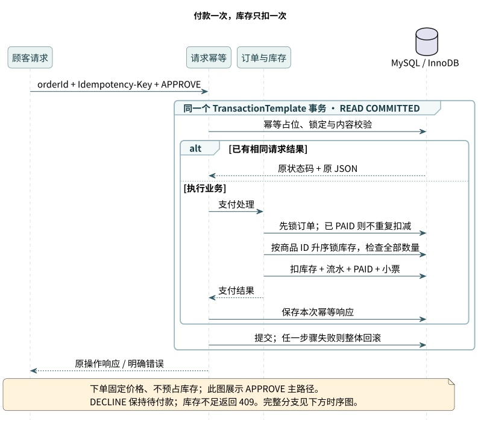
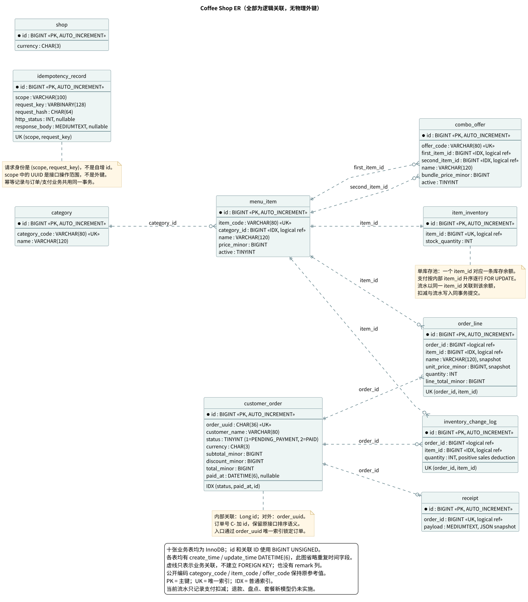

# Coffee Shop · Ordering & Payment

单店咖啡订单与模拟支付后端：**价格快照、请求幂等、并发库存扣减**，用同一个 MySQL 事务保持订单、库存流水与小票一致。

`Java 8` · `Spring Boot 2.7.18` · `MyBatis` · `MySQL 5.6.30 / InnoDB` · `Maven 3.6.3` · `ver2.0`

**[查看实现与测试](https://github.com/shinnlove/coffee-shop-jdk8-mysql56/tree/feature/2026-11-25/coffee_shop_ordering_and_payment/)** · **[本地运行](https://github.com/shinnlove/coffee-shop-jdk8-mysql56/blob/feature/2026-11-25/coffee_shop_ordering_and_payment/docs/QUICKSTART.zh-CN.md)** · **[设计说明](https://github.com/shinnlove/coffee-shop-jdk8-mysql56/blob/feature/2026-11-25/coffee_shop_ordering_and_payment/docs/DESIGN.md)** · **[验证记录](https://github.com/shinnlove/coffee-shop-jdk8-mysql56/blob/feature/2026-11-25/coffee_shop_ordering_and_payment/docs/VERIFICATION.md)**



> `master` 保存项目介绍与图示；实现、测试和运行文档在 `feature/2026-11-25/coffee_shop_ordering_and_payment`。本 README 在两个分支相同：图示使用相对路径，运行资料链接到实现分支。下方启动命令需先切到实现分支。

## 业务流程与设计

顾客查看菜单 → 创建待付款订单 → 模拟支付 → 获取小票；店主认证后查看已付款队列。

| 关注点 | 当前实现 |
| --- | --- |
| 价格 | 后端按整数最小货币单位计价；下单保存商品价格和订单金额快照 |
| 促销 | 自动匹配不重叠的 1+1 规则；示例 2 杯卡布奇诺 + 1 个可颂 = 1250 − 100 = 1150 |
| 幂等 | 相同作用域、key 和内容回放原 HTTP 状态及 JSON；相同 key 不同内容返回 409 |
| 库存 | 下单检查但不预占；支付先锁订单，再按商品 ID 升序锁库存、复核和扣减 |
| 事务 | 幂等结果、库存、扣减流水、PAID 状态和小票一起提交或回滚 |
| 身份 | 内部自增主键；外部保留商品 code 和订单 UUID，兼容原接口契约 |
| 店主接口 | Spring Security Basic + BCrypt；队列按 paidAt 和稳定次级规则排序 |

### 数据关系

十张 InnoDB 表；图中的虚线表示逻辑关联，数据库不建立物理外键。公共时间字段在图中省略，完整定义见 [V1 建表及种子脚本](https://github.com/shinnlove/coffee-shop-jdk8-mysql56/blob/feature/2026-11-25/coffee_shop_ordering_and_payment/src/main/resources/db/migration/V1__schema.sql)。



[打开 ER 原图](docs/diagrams/coffee_shop_er.svg) · [PlantUML 源码](docs/diagrams/er.puml)

### 完整业务时序

覆盖菜单、幂等创建、支付批准/拒绝、同单重试、小票和店主队列。点击展开，或打开原图放大查看。

<details>
<summary>展开多流程时序图</summary>


</details>

[打开时序原图](docs/diagrams/coffee_shop_business_sequence.svg) · [PlantUML 源码](docs/diagrams/business-sequence.puml) · [概览源码](docs/diagrams/overview.puml)

## 运行与验证入口

克隆后切换到实现分支，再在包含 `pom.xml` 的项目根目录运行：

```bash
git switch feature/2026-11-25/coffee_shop_ordering_and_payment
java -version
./mvnw -version
mysql -u root -p < scripts/init-local.sql
./mvnw spring-boot:run -Dspring-boot.run.profiles=local
```

本机需要 JDK 8、MySQL 5.6.30；Wrapper 固定 Maven 3.6.3，首次使用需要联网。初始化脚本只建库和账号，空库表结构与种子由 Liquibase 自动执行唯一 V1。已有数据请先看运行手册，不要重复手工建表。

另开终端执行 `./scripts/demo.sh`：五个接口分步骤展示，依赖 Python 3，会消耗演示库存。完整测试使用独立测试库，参见 [测试说明](https://github.com/shinnlove/coffee-shop-jdk8-mysql56/blob/feature/2026-11-25/coffee_shop_ordering_and_payment/docs/QUICKSTART.zh-CN.md)。

| 资料 | 入口 |
| --- | --- |
| IDEA、本地配置、测试、排障 | [本地运行手册](https://github.com/shinnlove/coffee-shop-jdk8-mysql56/blob/feature/2026-11-25/coffee_shop_ordering_and_payment/docs/QUICKSTART.zh-CN.md) |
| 两容器构建、目录挂载、启动/停止/重启 | [Docker 使用手册](https://github.com/shinnlove/coffee-shop-jdk8-mysql56/blob/feature/2026-11-25/coffee_shop_ordering_and_payment/docs/DOCKER.zh-CN.md) |
| 接口与参考数据 | [实际 OpenAPI](https://github.com/shinnlove/coffee-shop-jdk8-mysql56/blob/feature/2026-11-25/coffee_shop_ordering_and_payment/openapi.yaml) · [四份原始要求](https://github.com/shinnlove/coffee-shop-jdk8-mysql56/blob/feature/2026-11-25/coffee_shop_ordering_and_payment/reference/README.md) |
| 设计与需求覆盖 | [设计说明](https://github.com/shinnlove/coffee-shop-jdk8-mysql56/blob/feature/2026-11-25/coffee_shop_ordering_and_payment/docs/DESIGN.md) · [需求验收矩阵](https://github.com/shinnlove/coffee-shop-jdk8-mysql56/blob/feature/2026-11-25/coffee_shop_ordering_and_payment/docs/REQUIREMENTS.md) |
| 证据与 AI 使用 | [验证记录](https://github.com/shinnlove/coffee-shop-jdk8-mysql56/blob/feature/2026-11-25/coffee_shop_ordering_and_payment/docs/VERIFICATION.md) · [AI 与第三方资源说明](https://github.com/shinnlove/coffee-shop-jdk8-mysql56/blob/feature/2026-11-25/coffee_shop_ordering_and_payment/docs/AI_USAGE.md) |

**验证状态：** ver1.7 在真实 JDK 8 / Maven 3.6.3 / MySQL 5.6.30 上通过 71 个测试及原生启动、重启验证。ver1.9 保持业务源码、测试与 SQL 不变，修复文档与分发结构，检查结果单独记录。

提供 Docker Compose 启动配置、持久化目录挂载及自动化验收脚本，使用方式见 Docker 手册。

当前范围是后端作业切片：无顾客界面、库存预占、真实支付或多店隔离；复杂促销为扩展方向。演示账号只适用于本地测试。
